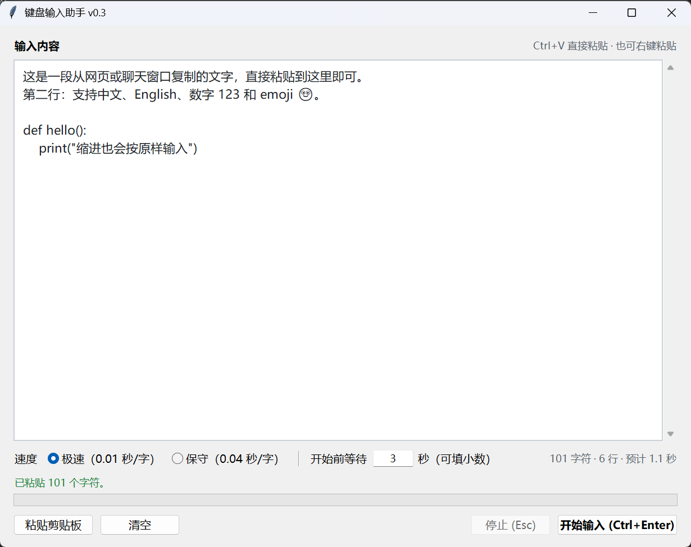

# 键盘输入助手 v0.3

把一段文本自动「敲」进当前光标所在的输入框。适合往网页表单、聊天窗口、远程桌面、虚拟机等**不允许粘贴**的地方批量输入内容。

界面版：要输入的文字直接在软件窗口里粘贴、编辑，**不再读写桌面上的 `input.txt`**。



## 特点

- **窗口内粘贴**：`Ctrl+V`、右键菜单或「粘贴剪贴板」按钮都可以；文本只保存在内存里，不生成任何 txt 文件。
- **Unicode 直发**：用 Windows `SendInput` 的 Unicode 模式逐字发送，完全绕过输入法——不用切换中英文，不经过选词，没有同音词 / 多音字问题。
- **不占用剪贴板**：输入过程不读剪贴板、不写入剪贴板，不会覆盖你复制的内容，也绕开「禁止粘贴」的限制。
- **零第三方依赖**：界面用 Python 自带的 `tkinter`，输入核心只用 `ctypes`，不需要 `pip install` 任何东西。
- **实时进度**：状态栏显示已输入字符数 / 百分比，进度条同步更新，完成后显示总字符数和耗时。
- **等待时间可调**：启动前留多少秒切换窗口由你在界面上直接填，默认 3 秒，支持小数。
- **可停止**：倒计时阶段可以取消，输入过程中可以中途停止。
- **误操作保护**：倒计时结束如果前台窗口还是本程序，会拒绝开始，避免把文字打回自己的输入框。

## 环境要求

- Windows 10 / 11
- Python 3.7 或更高（`tkinter` 随 Python 官方安装包提供）
- 目标程序若以管理员身份运行，本程序也需要用管理员身份运行（Windows 的 UIPI 限制）

## 使用

```bash
python 模拟键盘输入指定内容的脚本.py
```

1. 把要输入的内容粘贴到上方文本框（`Ctrl+V`、右键 → 粘贴，或点「粘贴剪贴板」）。
2. 选择速度：「极速」或「保守」。
3. 按需要在「开始前等待」里改倒计时秒数（默认 3 秒，可填小数）。
4. 点「开始输入」（或按 `Ctrl+Enter`）。
5. 倒计时期间，**把光标点进目标输入框**。
6. 程序开始逐字输入，状态栏和进度条实时显示进度。
7. 完成后可以修改文本框里的内容，再点一次开始，不需要重启程序。

### 开始前等待

「开始前等待」就是「点完开始、真正敲字之前留给你切换窗口的时间」，默认 `3` 秒。

- 可以填任意大于 0 的数字，支持小数：`0.5`、`1.5`、`10`、`60` 都行。
- 倒计时按实际秒数走，每 0.1 秒刷新一次状态；填 `0.5` 就不会傻等 3 秒。
- 填 `0`、负数、`nan`/`inf` 或非数字时，程序会拒绝开始并提示，焦点会回到这个输入框。
- 这个值只影响开始前的等待，不影响逐字输入的速度（速度由「极速 / 保守」决定）。
- 输入过程中该输入框会暂时锁定，结束后恢复可改。

### 停止

- 倒计时期间：点「停止」或按 `Esc` 直接取消。
- 输入过程中：点「停止」或按 `Esc`（需要先让本窗口获得焦点）。从目标窗口切回来的过程中，目标窗口可能还会收到少量残余按键，然后才会停下。

## 速度档位

启动后在界面上二选一，数值写在脚本开头的 `SPEED_PRESETS` 里：

| 档位 | `key_delay` 每字间隔 | `enter_delay` 换行等待 |
| --- | --- | --- |
| 极速 | 0.01 秒 | 0.015 秒 |
| 保守 | 0.04 秒 | 0.05 秒 |

**目标程序丢字就改用「保守」**；仍然丢字就改 `SPEED_PRESETS` 里的数字继续调大。间隔越大越稳，但整体越慢。

## 快捷键

| 快捷键 | 作用 |
| --- | --- |
| `Ctrl+V` | 粘贴剪贴板文本（会替换当前选区） |
| `Ctrl+Enter` | 开始输入 |
| `Enter`（在「开始前等待」输入框内） | 开始输入 |
| `Esc` | 停止输入 / 取消倒计时（本窗口有焦点时） |
| `Ctrl+Z` / `Ctrl+Y` | 撤销 / 重做 |
| `Ctrl+A` | 全选 |
| 右键 | 剪切、复制、粘贴、全选 |

## 打包成 exe

两种方式，**推荐 Nuitka**：体积约为 PyInstaller 版的一半，启动也更快，都会生成单文件、免安装 Python 环境的 exe。

### 方式一：Nuitka（推荐，体积更小）

先把依赖装上，然后运行仓库里的构建脚本：

```bash
pip install nuitka zstandard
python build_nuitka.py
```

- 产物在 `dist/键盘输入助手.exe`。
- 第一次构建时 Nuitka 会自己下载一份它认可的 MinGW-w64 编译器（约百余 MB，只下一次，之后走缓存），所以需要联网；本机已有的其它 gcc 会被忽略。
- `zstandard` 是 onefile 的压缩依赖。不装它 Nuitka 也能出包，但体积会从 5.7 MB 涨到 21 MB。
- exe 的版本信息（0.3.0.0、公司名、说明文字）由 `build_nuitka.py` 里的参数写入；改版本号时和三处保持一致：脚本的 `APP_VERSION`、`version_info.txt`、`build_nuitka.py`。

### 方式二：PyInstaller（不需要编译器）

```bash
pip install pyinstaller
pyinstaller --distpath dist_pyinstaller 键盘输入助手.spec
```

产物在 `dist_pyinstaller/键盘输入助手.exe`。spec 已设置 `console=False`，双击运行不会弹出黑色控制台窗口；版本资源（0.3.0）由 `version_info.txt` 提供。

### 两种方式的实测对比

同一份源码、同一台机器（Windows 11 + Python 3.11）打包后实测：

| 打包方式 | 产物体积 | 冷启动到窗口出现 |
| --- | --- | --- |
| Nuitka onefile（`build_nuitka.py`） | 5.72 MB | 约 0.6 秒 |
| PyInstaller onefile（`键盘输入助手.spec`） | 10.6 MB | 约 0.9 秒 |

两者都是运行时会解压到临时目录的单文件形式，行为和界面完全一致。

> `*.exe`、`build/`、`dist/`、`dist_pyinstaller/` 已在 `.gitignore` 中忽略，不会进版本库。需要分发时重新构建即可。

## 已知问题与处理

**输进去的字少了 / 顺序乱了**

目标程序处理按键的速度跟不上。改用「保守」档；仍然丢字就调大 `SPEED_PRESETS` 里的 `0.04`（比如 `0.08`），再不行继续往上加。

**报错「SendInput 失败」，或干脆毫无反应**

目标程序以管理员身份运行，而本程序不是。用管理员身份重新打开本程序。

**点了开始，却被提示「前台窗口还是本程序」**

说明设置的「开始前等待」太短，倒计时结束时焦点还在本程序上。把等待时间调大一些（比如 5～10 秒），先点一下目标窗口的输入框，再回来重新开始；或者把本窗口移到另一个屏幕后再操作。

**在代码编辑器里输入时缩进越来越深**

程序已经针对编辑器的自动缩进做了处理：每次换行前先按 `Esc` 关掉可能吃掉回车的代码提示弹窗，换行后用 `Shift+Home` 选中编辑器自动插入的缩进，替换成源文本里的真实缩进。如果某个编辑器的行为仍然对不上，可以按需调整 `newline_to` 函数。

**emoji 或生僻字输不进去**

BMP 之外的字符会拆成 UTF-16 代理对发送，理论上都支持。个别程序对代理对的接收方式特殊，可能失败。

## 说明

- 程序只会向**当前获得焦点的窗口**发送按键。输入开始后不要再切换窗口或点击其他地方，否则后续按键会落到新窗口里。
- 文本只存在内存中：关闭程序后内容不会保留，也不会在磁盘上留下副本。
- 「开始前等待」也只在本次运行内有效，重新打开程序会恢复默认的 3 秒。
- `input.txt` 的旧用法已经移除，程序不再读写桌面文件。
- 倒计时由界面定时器每 0.1 秒刷新，逐字输入在后台线程里进行，界面不会卡住；输入期间文本框会暂时变为只读。
